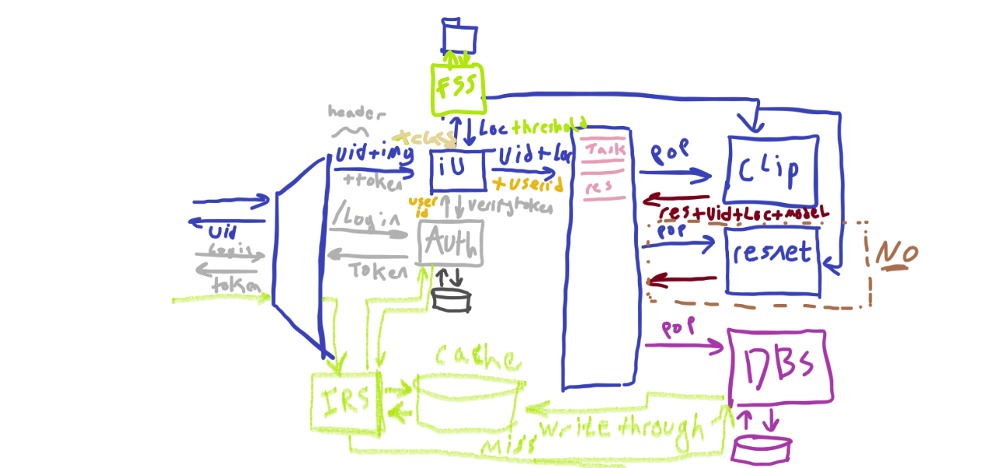
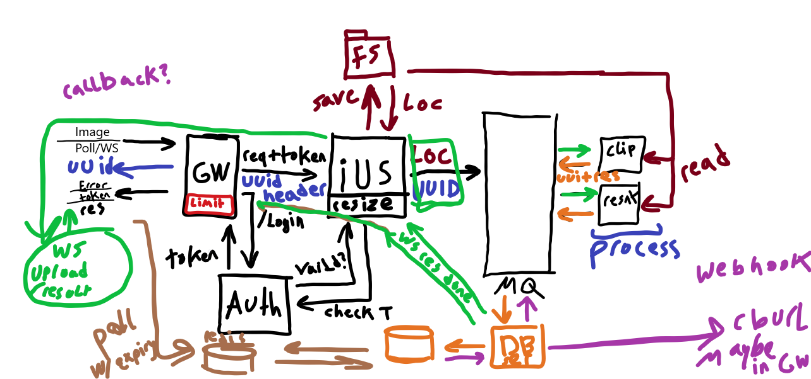

# Developing an Affordable Image Moderation System using OpenAI's CLIP Model and FastAPI Framework

This repository holds two parts of the same 2023 project:

1. **The thesis** (root of the repo): the CLIP + FastAPI classifier, the model tester, and the thesis papers (English and Arabic) and presentation.
2. **The microservice system** ([`microservices/`](microservices/)): the full moderation pipeline built around that classifier, using NestJS services, a RabbitMQ task queue and Python CLIP workers.

> **Status:** 2023 work in progress, published as it was left. The code is unchanged except that hard-coded secrets were replaced with `***REDACTED***`, so set your own values (environment variables) before running anything.

## Abstract:

This research focuses on designing a cost-effective content moderation system for user-generated multimedia content by integrating OpenAI's CLIP model into a FastAPI-based asynchronous RESTful API.
Our system primarily targets image content classification, specifically nudity, gore, offensive content, and facial attributes.
It seeks to address the challenges of efficient data handling, model inference, and response formatting while maintaining flexibility across different classification scenarios.
This study aims to contribute to the field of content moderation by enhancing the accuracy and efficiency of harmful content detection, 
fostering a safer online environment.

## Objectives:

This thesis aims to develop a FastAPI-based web application that effectively integrates the CLIP model for image classification. The specific objectives are:

1. To create a FastAPI service that accepts image data either as a file upload or a URL.
2. To use the CLIP model efficiently for image classification based on user-specified classes.
3. To design the system to dynamically handle multiple classification scenarios and adapt to different classifiers and class inputs.
4. To evaluate the system's effectiveness and applicability in various image classification scenarios.

## Goal Statement:

The main goal of this study is to create an affordable, efficient, and adaptable content moderation system for user-generated multimedia content.
The proposed system utilizes OpenAI's CLIP model for image classification tasks and FastAPI for designing an asynchronous RESTful API.
It is aimed at dynamically handling multiple classification scenarios,thereby enhancing the accessibility and utility of image classification technology in real-world applications.

## Full System Diagram:


## The microservice system

The classifier became one stage of a pipeline:
1. A client uploads an image through the gateway.
2. The image is stored and queued.
3. CLIP workers classify it.
4. The result is persisted for the client to collect.



| Service | Folder | What it does | Built with |
|---|---|---|---|
| API gateway | [`microservices/api-gateway`](microservices/api-gateway) | Single entry point; proxies requests to the services | NestJS, `http-proxy-middleware` |
| Auth | [`microservices/auth-microservice`](microservices/auth-microservice) | Login and JWT issuing/validation for the other services | NestJS (TCP transport), Passport-JWT, bcrypt, TypeORM |
| Image upload | [`microservices/image-upload-microservice`](microservices/image-upload-microservice) | Accepts images, resizes them, hands them to the file server and publishes classification tasks | NestJS (TCP transport), `sharp`, RabbitMQ (`amqplib`) |
| File server | [`microservices/file-server-microservice`](microservices/file-server-microservice) | Stores uploaded images and returns their location | NestJS, Multer |
| Database | [`microservices/database-microservice`](microservices/database-microservice) | Consumes moderation results from the queue and persists them | NestJS (RabbitMQ transport), TypeORM |
| Image retrieval | [`microservices/image-retrival-microservice`](microservices/image-retrival-microservice) | Lets clients fetch moderation results | NestJS, TypeORM |
| CLIP workers | [`microservices/python_services`](microservices/python_services) | Pull tasks from RabbitMQ, run CLIP zero-shot classification, return results; REST variants for direct calls | Python, FastAPI, `aio_pika`, Hugging Face `transformers` (CLIP), PyTorch |

A later sketch of the request flow, including the planned rate limiting, WebSocket/poll result delivery and a Redis cache for results:



**Planned but not implemented:** Redis caching, Kafka and gRPC appear as dependencies, but the code doesn't use them yet. ResNet was dropped in favour of CLIP.

### Running a service

Each NestJS service is a standard Nest CLI project:

```bash
cd microservices/<service>
npm install
npm run start:dev
```

The Python workers are started with uvicorn. The exact command is in a comment at the bottom of each file, e.g.:

```bash
uvicorn clip_classifier_consumer:app --host 0.0.0.0 --port 6005
```

They expect RabbitMQ on `localhost:5672` and a database. Fill in the redacted credentials through your own configuration.

## Conclusion

Our FastAPI and CLIP-based image classifier development remains a work in progress.
By maintaining a focus on continuous improvement and adapting to the ever-evolving technological landscape, the application promises to remain a formidable tool for image classification tasks.
The enhancements proposed in this paper outlines potential for further refining the application's functionality and utility.
